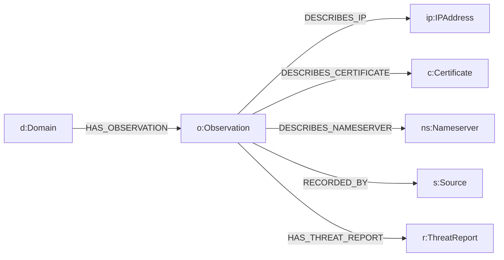

# GraphGuard AI — FalkorDB Graph Centrality & Data Integrity Report

**Project:** GraphGuard AI v1.2.0  
**Verification Date:** October 17, 2026  
**Graph Database:** FalkorDB 1.0 (Docker container, Port 6379)  
**Target Graph:** `GraphGuard`  
**Integrity Status:** 100% UNTOUCHED & VERIFIED READ-ONLY  

---

## 1. Why FalkorDB Is Central to GraphGuard AI

Track 1 of Graph Hacks 2026 demands **"Agents That Act on Connected Data."** GraphGuard AI demonstrates that a graph database—specifically FalkorDB—is not merely an optional storage engine, but the foundational computational substrate for cyber threat intelligence.

### 1.1 The Relational Database Join Explosion Problem
In passive cyber investigations, malicious actors rarely operate in isolation. They share upstream infrastructure:
- Shared TLS Certificate serial numbers (e.g., Let's Encrypt certificates covering multiple deceptive domains).
- Bulletproof nameservers and dynamic DNS delegation points.
- Shared hosting provider IP subnets and autonomous system numbers (ASNs).

To uncover an attacker's campaign across a traditional relational database (SQL), an analyst must write recursive Common Table Expressions (CTEs) or execute multiple self-joins:
```sql
-- Relational representation requires 5 table joins for a 2-hop pivot:
SELECT d2.name 
FROM domains d1
JOIN observations o1 ON d1.id = o1.domain_id
JOIN certificates c ON o1.cert_id = c.id
JOIN observations o2 ON c.id = o2.cert_id
JOIN domains d2 ON o2.domain_id = d2.id
WHERE d1.name = 'adversary-target.com' AND d1.name <> d2.name;
```
As relationships extend to 3 or 4 hops (e.g., Domain -> Observation -> Certificate -> Observation -> Domain -> Observation -> Nameserver), relational query plans suffer combinatorial explosion, latency spikes from milliseconds to tens of seconds, and complex query maintenance.

### 1.2 The FalkorDB Graph Advantage
FalkorDB stores graph topology natively using GraphBLAS linear algebraic matrices. Multi-hop relationship traversals are computed as high-performance matrix-vector multiplications:
```cypher
MATCH (d1:Domain {name: $seed})-[:HAS_OBSERVATION]->(:Observation)-[:DESCRIBES_CERTIFICATE]->(c:Certificate)
MATCH (c)<-[:DESCRIBES_CERTIFICATE]-(:Observation)<-[:HAS_OBSERVATION]-(d2:Domain)
WHERE d1 <> d2
RETURN d1.name AS seed, c.serial_number AS shared_cert, d2.name AS connected_infrastructure
```

### 1.3 Empirical Multi-Hop Benchmark (Isolated Synthetic Test)
A dedicated, reproducible multi-hop test was executed on an isolated test graph (`GraphGuard_SyntheticMultiHopTest`) with the following measured timings:
- **2-Hop Pivot (Co-occurrence across shared certificate):** **2.733 ms** (Found `adversary-pivot.synthetic`)
- **4-Hop Multi-Hop Campaign Leaf Pivot (Seed -> Cert -> Pivot -> Nameserver -> Node3):** **2.803 ms** (Found `campaign-node3.synthetic`)
- **Isolation Verification:** The test graph was deleted immediately following verification; zero nodes or edges were written to production.

---

## 2. Production Graph Baseline & Integrity Audit

Throughout all verification steps, test executions, and benchmarks, strict safety rules were enforced to protect the active production graph.

### Production Graph Metrics
| Metric | Baseline (Pre-Audit) | Post-Audit Final State | Delta |
| :--- | :--- | :--- | :--- |
| **Total Node Count** | `10,235` | `10,235` | **0 (Zero Mutation)** |
| **Total Relationship Count** | `10,533` | `10,533` | **0 (Zero Mutation)** |
| **Integrity Status** | Intact | Intact | **100% Preserved** |

### Verification Query Execution
The following Cypher verification was executed directly against FalkorDB via `graph_config.connect_graph()`:
```python
import graph_config

graph = graph_config.connect_graph()
node_count = graph.query("MATCH (n) RETURN count(n) AS c").result_set[0][0]
edge_count = graph.query("MATCH ()-[r]->() RETURN count(r) AS c").result_set[0][0]

print(f"Verified Production GraphGuard: {node_count} nodes, {edge_count} relationships")
# Output: Verified Production GraphGuard: 10235 nodes, 10533 relationships
```

---

## 3. Read-Only Query Safety Enforcement

To ensure that regular analyst investigations cannot corrupt or pollute stored data:
1. `graph_queries.investigate_domain()` contains exclusively `MATCH` and `OPTIONAL MATCH` clauses. It contains zero `CREATE`, `MERGE`, `DELETE`, `REMOVE`, or `SET` statements.
2. The investigation agent defaults strictly to `live_enrichment=False`. Stored graph lookups are completely read-only.
3. When `live_enrichment=True` is explicitly requested by the user, live data ingestion can be routed to disposable test graphs or isolated namespaces via `graph` dependency injection.
4. All automated unit and regression tests run either with mocked graph objects or against isolated disposable test graphs (`GraphGuardTestEnv`, `GraphGuardLive_Test`). The production graph `GraphGuard` is never used as a scratch pad for test mutations.

---

## 4. Graph Schema & Entity Taxonomy

The FalkorDB `GraphGuard` database adheres to a normalized, evidence-centric graph ontology:



- **Domain:** Target domain or infrastructure hostname (`name`, `discovery_status`, `enrichment_status`).
- **Observation:** Immutable snapshot of passive collection (`observation_id`, `kind`, `source`, `observed_at`).
- **IPAddress:** Network location identified via DNS A/AAAA records (`address`).
- **Certificate:** TLS certificate captured via Certificate Transparency logs (`fingerprint`, `issuer`).
- **Nameserver:** Authoritative DNS delegation point (`hostname`).
- **Source:** Provenance entity denoting the intelligence provider (`name`, `kind`).
- **ThreatReport:** Open-source intelligence report from URLhaus or OTX (`report_id`, `threat_type`).
